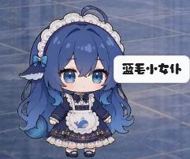
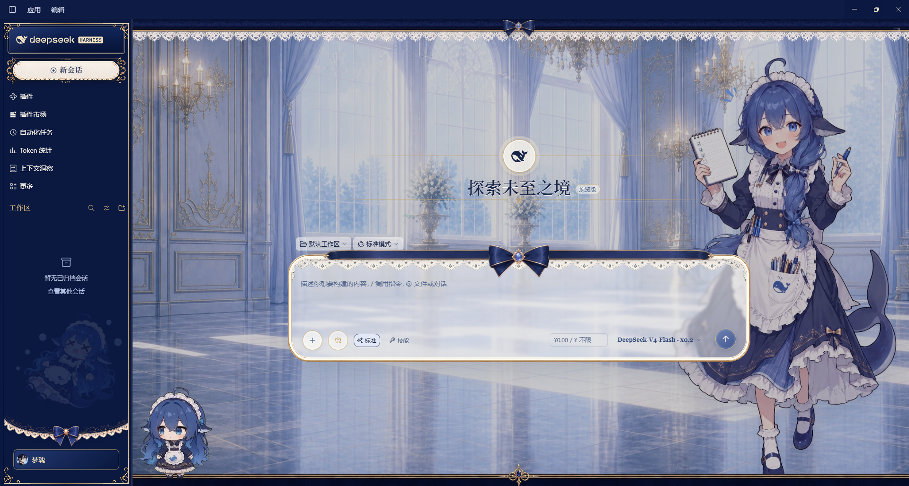

# 安装

进入[DeepSeek Harness](https://www.deepseek.com/harness/)官网下载系统对应的版本继续安装。

安装完成后登陆deepseek账号即可开始食用了，非常方便。

# 使用

## 插件安装

1. 安装关键插件——“插件市场”

   安装插件就跟给游戏打mod一个道理，而”插件市场“就相当于steam的创意工坊。

   步骤：进入`左侧工具栏`的`插件`，点击右上角的`添加插件`，输入`dshmarket`即可安装。

2. 可选插件安装

- 实用插件

| #          | 插件                                                          | 作用                                 | 单独安装                                                                     |
| :--------- | :---------------------------------------------------------- | :--------------------------------- | :----------------------------------------------------------------------- |
| ~~**01**~~ | ~~**dshmarket**<br>插件市场~~                                   | ~~在 DSH 中浏览、搜索、安装和管理社区插件。~~        | ~~`dsh plugin --profile desktop add dshmarket`~~                         |
| **02**     | **dsh-context**<br>上下文查看                                    | 查看会话上下文的组成、用量与变化。                  | `dsh plugin --profile desktop add dsh-context`                           |
| **03**     | **dsh-token-diet**<br>内容精简 / 省 Token                        | 精简文本、JSON、CSV 等内容，减少冗长输入占用。        | `dsh plugin --profile desktop add dsh-token-diet`                        |
| **04**     | **billion-context**<br>长对话压缩 / 省 Token                      | 压缩和管理长会话上下文，帮助长任务控制用量。             | `dsh plugin --profile desktop add billion-context`                       |
| **05**     | **＠liustack/modlens**<br>图片理解                               | 为纯文本模型接入视觉能力，让模型参考图片。              | `dsh plugin --profile desktop add ＠liustack/modlens`                     |
| **06**     | **dsh-at-file**<br>工作区文件引用                                  | 输入 at符号 搜索并引用工作区文件；发送时按插件实现加入文件内容。 | `dsh plugin --profile desktop add dsh-at-file`                           |
| **07**     | **dsh-genui**<br>交互式回复界面                                    | 把回复呈现为交互式表格、图表、表单、测验等。             | `dsh plugin --profile desktop add dsh-genui`                             |
| **08**     | **＠vectorize-io/**<br>**hindsight-coding-agents**<br>项目长期记忆 | 记录项目历史与会话信息，在后续会话中召回知识。            | `dsh plugin --profile desktop add ＠vectorize-io/hindsight-coding-agents` |
| **09**     | **＠ebony-vinyl/**<br>**dsh-our-free-model**<br>免费模型入口       | 在模型选择器中提供第三方免费模型及可用性信息。            | `dsh plugin --profile desktop add ＠ebony-vinyl/dsh-our-free-model`       |
| **10**     | **＠weibaohui/**<br>**skills-management**<br>技能管理与市场         | 查看、导入本机其他编码助手的技能，并浏览技能市场。          | `dsh plugin --profile desktop add ＠weibaohui/skills-management`          |

- 桌宠插件



  步骤：进入`左侧工具栏`的`插件`，点击右上角的`添加插件`，输入`dsh-pet`即可安装。

- 美化插件

|插件|npm 包名|
|---|---|
|[maid-atelier](https://www.npmjs.com/package/@smalltailqwq/dsh-client-ui-skin-maid-atelier)|`@smalltailqwq/dsh-client-ui-skin-maid-atelier`|
|[orca-link](https://www.npmjs.com/package/@smalltailqwq/dsh-client-ui-skin-orca-link)|`@smalltailqwq/dsh-client-ui-skin-orca-link`|
|[皮肤管理器](https://www.npmjs.com/package/@smalltailqwq/dsh-client-ui-skin-deep-whale-manager)|`@smalltailqwq/dsh-client-ui-skin-deep-whale-manager`|



## 懒人插件安装法——提示词法

直接让AI帮我安装插件。

```MARKDOWN
装一下dsh-market这个插件，并告诉我如何使用
```

:::warning
该法可能耗费token较多，本人使用耗费6元多token都没把插件下齐。尽量选择手动安装好。
:::

# 总结

本期主要介绍deepseek harness的基础使用方法，关于插件的配置和AI具体如何使用的方法看本人心情再更。

# 参考视频

本文章主要受到视频[【小白必看】DeepSeek Harness零基础教程！附大肥鱼全套案例！哔哩哔哩_bilibili](https://www.bilibili.com/video/BV1DY4v6DEtz/?)启发。

<iframe width="100%" height="468" src="//player.bilibili.com/player.html?bvid=BV1DY4v6DEtz&p=1&autoplay=0" scrolling="no" border="0" frameborder="no" framespacing="0" allowfullscreen="true"> </iframe>