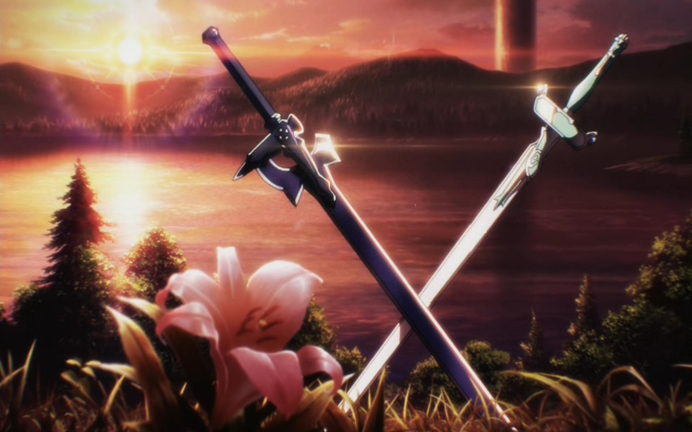

# 关于

大家好，我是云兮安梦。爱好：计算机系统、游戏、音乐和动漫。
# 网名演变史
## 第一代

⌈安仲恺⌋，「安」是我喜欢的一个小众歌手别名的姓氏，「仲」可能是受当年《王者荣耀》出了新皮肤「**仲夏夜之梦**」所启发。这个当我的别名很不错，以后万一写出来了个不错的小说、漫画、作曲的话会派上用场的。

## 第二代

⌈刀光下的惬意⌋，看过《刀剑神域》后，觉得「桐人」拿着双刀很帅。用下面这张图片来形容一下意境就再合适不过了：桐人在打完boss后，跟亚丝娜一起坐在池塘边，一边看着手里征战无数boss的刀焕发出来闪亮的刀光，一边惬意地闲聊……

## 第三代

⌈梦魂⌋，我很喜欢「梦」，因为梦里可以见到现实中无法见到之人。只要我还记得他，他的「魂」就还在，至少可以在梦里见面，已经很知足了。

## 第四代

⌈云兮安梦⌋，其实是上一代的「梦魂」改版。一开始脑子里蹦出来了一个念头：我把「梦魂」拆开，由「林」、「夕」、「云」、「鬼」这四个字构成，因为我从小很怕「鬼」，所以心里面默念了几遍「林、夕、云」，再想到第一代「安」，于是就有了「云兮安梦」。意境的话可以想象一下，躺在软绵绵的云朵上，安然地进入梦乡……

# 关于我二次元浓度

高二寒假，入坑二次元神作——《刀剑神域》。害，我也不清楚浓度有多少，姑且算个小萌新。在高二以前我的爱好只有game和音乐，如果放在初中的话，那个时候，根本听不懂日语，:spoiler[说的什么鸟语啊（虽然现在依旧听不懂）]，打死我也想不到自己后来会爱上看日漫。那年高二发生了好多好多事，心情很糟吧，就在这种情况下，被「桐人」伙伴之间的友情也好、爱情也好，所治愈，想到还有着这样理想的世界，说夸张点，这也算我活着的意义——为了多看几部番，见识到不一样的世界。

## 最喜欢的角色

朝田诗乃
## 推
1. 夏洛特
2. 别当欧尼酱了！
3. 天使降临到了我身边！
4. 天使降临到了我身边！Precious
5. 夏日重现
6. 幸运星
7. 知晓天空之蓝的人啊
8. 铃芽之旅
9. 天气之子
10. 通往夏天的隧道，再见的出口
11. 你好 世界
12. 你的名字
13. 超时空辉夜姬
14.  蓦然回首

::github{repo="YXANM/my-blog"}

> ### Sources of images used in this site
> - [Unsplash](https://unsplash.com/)
> - [星と少女](https://www.pixiv.net/artworks/108916539) by [Stella](https://www.pixiv.net/users/93273965)
> - [Rabbit - v1.4 Showcase](https://civitai.com/posts/586908) by [Rabbit_YourMajesty](https://civitai.com/user/Rabbit_YourMajesty)